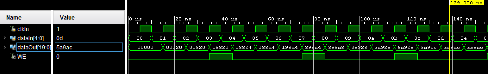
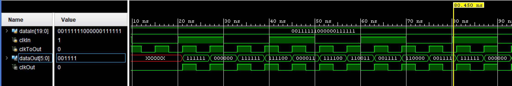

# 🔄 Serializer & Deserializer (Verilog HDL)

Реализация модулей сериалайзера (**20 → 6**) и десериалайзера (**5 → 20**) на языке Verilog HDL.

Проект разработан и протестирован в среде **Xilinx Vivado**.

---

## 📁 Структура проекта

```text
.
├── serial_deserial.xpr         # Файл проекта Vivado
├── README.md                   # Документация проекта
├── .gitignore                  # Исключения для системных файлов Vivado
│
└── serial_deserial.srcs/
    ├── sources_1/new/          # Исходный код модулей (RTL)
    │   ├── deserial5x20.v      # Десериалайзер (5 в 20)
    │   └── serial20x6.v        # Сериалайзер (20 в 6)
    │
    └── sim_1/new/              # Тестовые окружения (Testbenches)
        ├── deserial5x20_tb.v
        └── serial20x6_tb.v
```

---

## 🛠 Описание модулей

### 1. Десериалайзер `deserial5x20`
Принимает 5-битные последовательные порции данных по тактовому сигналу `clkIn` и собирает их в итоговое 20-битное параллельное слово.

* **Параметры:**
  * `in = 5` — ширина входной шины.
  * `out = 20` — ширина выходной шины.
* **Порты:**
  * `clkIn` (`input wire`) — тактовый сигнал.
  * `dataIn` (`input wire [4:0]`) — входные 5-битные данные.
  * `dataOut` (`output reg [19:0]`) — выходящее 20-битное слово.
  * `WE` (`output reg`) — Write Enable (импульс готовности данных продолжительностью в 1 такт).

---

### 2. Сериалайзер `serial20x6`
Преобразует параллельное 20-битное слово в последовательный поток 6-битных данных.

* **Параметры:**
  * `in = 20` — ширина входной шины.
  * `out = 6` — ширина выходной шины.
* **Порты:**
  * `clkIn` (`input wire`) — тактовый сигнал записи.
  * `clkToOut` (`input wire`) — тактовый сигнал выдачи данных.
  * `dataIn` (`input wire [19:0]`) — входные параллельные данные.
  * `dataOut` (`output reg [5:0]`) — выходящий 6-битный поток.
  * `clkOut` (`output wire`) — строб-сигнал синхронизации выходящих данных.

---

## 📊 Результаты симуляции

Волна симуляции получена с помощью **Vivado Simulator**.

### Работа десериалайзера
На временной диаграмме показана сборка 20-битного слова из 4-х последовательных 5-битных пакетов. По завершении сборки формируется короткий импульс флага `WE`:

<p align="center">
  
</p>

### Работа сериалайзера
Преобразование параллельного слова в последовательность 6-битных пакетов:

<p align="center">
  
</p>

